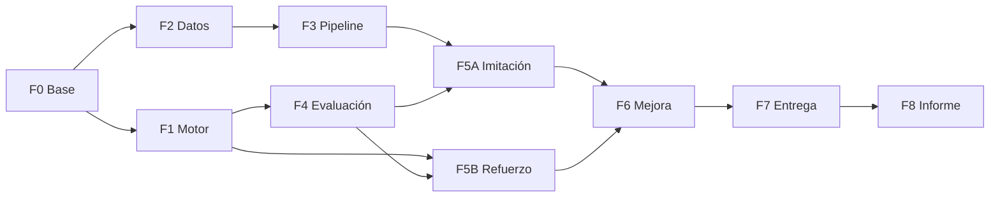

# Plan del proyecto: agente visual para SuperTuxKart

Objetivo: un agente que conduzca bien viendo **solo la imagen con HUD**, listo para que el profesor lo ejecute solo.
Plazo: ~30 días desde 2026-10-30, ~2 h/día.

**Estados:** ✅ hecho · 🔄 en curso · ⬜ pendiente
**GPU:** No = CPU basta · Opc = acelera · **Sí** = necesaria
**Quién:** H = humano · C = Claude

## Dónde estoy

**Semana 3 · día 17 (2026-11-15).** Estudiante `teacher_r0` entrenado y evaluado: **termina las pistas vistas (2/2) y ninguna de las nuevas (0/3)**, puesto 8/8. Ahora corre **DAgger ronda 1** en el PC (60 carreras, ~2 h, sube a Drive).
**Siguiente (H):** cuando termine DAgger, Colab con `PRESET='teacher_r1'` (GPU). Luego `pull` + `eval`.
**Saldo Colab:** 167 unidades (un entrenamiento ≈ 2 unidades: no es el límite).

## Rondas (el plan que seguimos)

| Ronda | Datos | Quién conduce al generar | Entrena | Se mide |
|---|---|---|---|---|
| r0 ✅ | 120 carreras del profesor + ruido | profesor | `teacher_r0` | 2/2 vistas, 0/3 nuevas |
| r1 🔄 | +60 carreras, β=0.5 | estudiante r0 la mitad del tiempo, profesor corrige | `teacher_r1` = r0+r1 | pistas nuevas |
| r2 ⬜ | +60, β=0.3 | estudiante r1 | `teacher_r2` | ídem |
| r3 ⬜ | +60, β=0.1 | estudiante r2 | modelo final **sin** pistas retenidas para validar | semillas distintas |

Cada ronda = ~2 h PC (de noche) + ~40 min Colab + ~20 min evaluar. Meta: terminar pistas nuevas; después, velocidad vs bots.
**Límites:** nada nuevo después del día 26 (24-nov); últimos 3 días solo empaquetar (F7). Si tras r2 las pistas nuevas siguen en 0, se cambia de estrategia (más variedad de karts/clima, modelo más grande).

## Mapa

**En paralelo desde ya:** motor/evaluación (F1→F4) · datos (F2→F3) · refuerzo (F5B.1).
**Ruta crítica:** F2.1 → F2.2 → F2.4 → F3.3 → F5A.2 → F5A.3 → F6 → F7 → F8.2

---

## F0 · Base (sin GPU)

| | Paso | Entregable | Depende | Quién |
|---|---|---|---|---|
| ✅ F0.2 | Entorno Python 3.11 | `doctor --engine` OK | — | H |
| ✅ F0.3 | Decidir cómputo | Colab con plan Google AI Pro | — | H |
| 🔄 F0.1 | Repo y compañero | Repo `apex_kart` creado; **falta invitar al compañero** | — | H |
| 🔄 F0.4 | Dudas del enunciado | Respuestas en `ENUNCIADO.md`; falta criterio de nota y formato de entrega | — | H |
| 🔄 F0.5 | Convenciones | Carpetas, datos fuera de git, semillas, registro | F0.1 | H+C |

## F1 · Motor y línea base (sin GPU)

| | Paso | Entregable | Depende | Quién |
|---|---|---|---|---|
| ✅ F1.1 | Listar pistas y karts | `results/assets.json` | F0.2 | C |
| ✅ F1.2 | Velocidad del simulador | ~2.5× tiempo real | F1.1 | C |
| ✅ F1.3 | Agente trivial | `agents/const_accel` | F1.1 | C |
| ✅ F1.4 | Línea base | 0 de 12 carreras terminadas | F1.3 | C |

## F2 · Datos (sin GPU)

| | Paso | Entregable | Depende | Quién |
|---|---|---|---|---|
| ✅ F2.1 | Datos de todos los grupos | Copia en tu Drive: 928 episodios, 123.5 GiB | F0.1 | **H** |
| ✅ F2.2 | Auditar | `results/audit_dataset.md` (41 h, 24 grupos) | F2.1 | C |
| ⬜ F2.3 | Grabar datos propios | Episodios que cubran los huecos | F2.2 | H |
| 🔄 F2.4 | Congelar split | Validación en pistas no vistas: `configs/train/bc_v1.json` | F2.2 | H+C |

## F3 · Pipeline de datos (sin GPU)

| | Paso | Entregable | Depende | Quién |
|---|---|---|---|---|
| 🔄 F3.1 | Explorar | `results/exploracion_muestras.md` | F2.2 | C |
| ✅ F3.2 | Alinear imagen y acción | Verificado en las muestras | F2.2 | C |
| ✅ F3.3 | Formato compacto | `tools/preprocess.py` | F3.2 | C |
| ✅ F3.4 | Curar datos | `results/subset_v1.txt`: 207 episodios, podio, ≤20 por pista | F3.1 | H+C |

## F4 · Evaluación (sin GPU)

| | Paso | Entregable | Depende | Quién |
|---|---|---|---|---|
| 🔄 F4.1 | Métricas | Terminadas, tiempo, posición, distancia | F0.4 | H+C |
| 🔄 F4.2 | Pistas de evaluación | `configs/eval_set.json` (provisional) | F2.4 | H+C |
| ✅ F4.3 | Arnés automático | `tools/evaluate.py` | F1.3 | C |
| ⬜ F4.4 | Medir ruido | Varianza entre semillas | F4.3 | C |

## F5A · Imitación

| | Paso | Entregable | Depende | GPU | Quién |
|---|---|---|---|---|---|
| ✅ F5A.1 | Prueba de humo | Entrena y el agente corre | F3.3 | Opc | C |
| ✅ F5A.2 | Primer modelo real | `bc_teacher_r0` entrenado en Colab (val 0.35) | F5A.1, F2.4 | **Sí** | H+C |
| ✅ F5A.3 | Medir conduciendo | `runs/eval_bc_teacher_r0_*`: vistas 2/2, nuevas 0/3 | F5A.2, F4.3 | Opc | C |

## F5B · Refuerzo

| | Paso | Entregable | Depende | GPU | Quién |
|---|---|---|---|---|---|
| ✅ F5B.1 | Entorno y recompensa | `training/rewards.py` | F1.2 | No | C |
| ✅ F5B.2 | Profesor con estado interno (opcional) | `training/teacher.py`: sigue la línea de la pista; termina las 21 pistas | F5B.1 | Opc | C |
| 🔄 F5B.3 | Estudiante desde imagen | Estudiante imita al profesor (DAgger): `teacher_r0`, luego `teacher_r1` | F5B.1, F4.3 | **Sí** | H+C |

Con ~1.5× tiempo real, RL puro desde píxeles es caro: se decide el día 14.

## F6 · Mejora (GPU según el caso)

| | Paso | Entregable | Depende | Quién |
|---|---|---|---|---|
| 🔄 F6.1 | Analizar fallos | Falla en pistas nuevas: errores acumulados → DAgger | F5A.3 | C |
| ⬜ F6.2 | Una mejora por vez | Más datos, aumento, corrección con datos propios del agente | F6.1 | H+C |
| ⬜ F6.3 | Comparar | Tabla antes/después, mismas semillas | F6.2, F4.4 | C |

## F7 · Entrega (sin GPU)

| | Paso | Entregable | Depende | Quién |
|---|---|---|---|---|
| ⬜ F7.1 | Agente autocontenido | Carpeta con `agent.json`, pesos y pesos portables; usa GPU si hay, si no CPU | F6 | C |
| ⬜ F7.2 | Probar en máquina limpia | `play` y `race` desde cero | F7.1 | H |
| ⬜ F7.3 | Latencia y robustez | Tiempo por acción, pistas nuevas | F7.1 | C |
| ⬜ F7.4 | Congelar versión | Etiqueta en git + dependencias | F7.2, F7.3 | H+C |

## F8 · Informe (sin GPU)

| | Paso | Entregable | Depende | Quién |
|---|---|---|---|---|
| ⬜ F8.1 | Bitácora | Experimentos y tablas | F4.3 | H+C |
| ⬜ F8.2 | Informe o presentación | Formato según F0.4 | F6.3, F8.1 | H |

---

## Calendario

| Semana | Foco | Pasos |
|---|---|---|
| 1 (días 1–7) | Base y datos | F0, F1, F2.1–F2.2, F4.1–F4.3 |
| 2 (días 8–14) | Primer modelo | F2.4, F3, F5A. **Corte día 14: un agente que complete vueltas** |
| 3 (días 15–21) | Mejora | F6, F2.3, F4.4; F5B solo si el agente base ya anda |
| 4 (días 22–30) | Cierre | F6.3, F7, F8. Últimos 3 días solo para empaquetar |

**Reglas:** sin agente que complete vueltas el día 14, se descarta RL. Nada nuevo después del día 26.

## GPU de un vistazo

- **Sin GPU (puedes avanzar ya):** F0, F1, F2, F3, F4, F7, F8, F5B.1
- **Opcional:** F5A.1, F5A.3, F5B.2
- **Necesaria:** F5A.2, F5B.3, entrenamiento de F6.2
