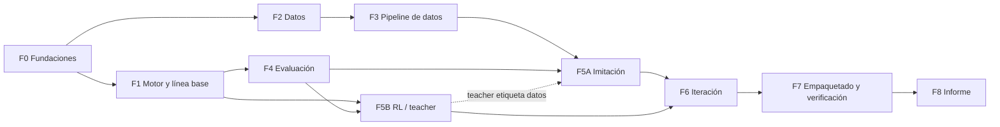

# Plan del proyecto: agente visual para SuperTuxKart

Plan por fases, agnóstico de herramientas. Cada paso tiene un ID, entregable verificable, dependencias y requisito de GPU.
**Estado actual:** actualizar la columna `Estado` (`[ ]` pendiente · `[~]` en curso · `[x]` hecho) y la línea de abajo.

> **Estás en:** F0 (ver tabla). Última actualización: 2026-10-30.

## Leyenda

- **Dep.**: pasos que deben estar `[x]` antes de empezar. `—` = puede empezar ya.
- **Paralelo con**: pasos que pueden avanzar a la vez sin bloquearse.
- **GPU**: `No` = CPU basta · `Opc` = acelera pero no es obligatoria · `Sí` = necesaria en la práctica.
- **Quién**: `H` = humano (tú/compañero) · `C` = Claude · `H+C` = juntos.
- Dos restricciones del curso que condicionan todo: la política recibe **solo RGB con HUD** al evaluar (el estado privilegiado solo sirve para entrenar/etiquetar), y el agente debe poder ejecutarlo el profesor de forma independiente (sin restricción declarada de CPU/GPU ni de tiempo: **confirmarlo, ver F0.4**).

## Mapa de dependencias

Tres carriles se pueden mover **a la vez** tras F0: **(a) motor + evaluación** (F1→F4), **(b) datos** (F2→F3), **(c) decisión de cómputo/infraestructura** (F0.3). F5A y F5B son alternativas/complementos que también corren en paralelo cuando F3 y F4 están listos.

## F0 · Fundaciones (organización y entorno) — sin GPU

| ID | Paso | Entregable | Dep. | Paralelo con | GPU | Quién | Estado |
|----|------|-----------|------|--------------|-----|-------|--------|
| F0.1 | Repo en GitHub + colaborador | Repo privado creado, compañero invitado | — | F0.2, F0.4 | No | H+C | [ ] |
| F0.2 | Entorno reproducible | Entorno Python 3.11 con `pip install -e .` y `doctor --engine` OK en tu máquina | — | F0.1, F0.4 | No | H | [ ] |
| F0.3 | Decisión de cómputo | Entrenar en Colab con el plan Google AI Pro (200 compute units/mes, 5 TB Drive). Promo de 3 meses; luego sube de precio | — | F0.2 | No | H | [x] |
| F0.4 | Aclarar `[COMPLETAR]` con el profesor | Criterio de evaluación, formato de entrega, tiempo/cómputo en inferencia confirmados en `docs/ENUNCIADO.md` | — | todo | No | H | [ ] |
| F0.5 | Convenciones de trabajo | Estructura de carpetas, política de datos fuera de git, semillas, registro de experimentos | F0.1 | F0.2 | No | H+C | [ ] |

**Hecho cuando:** ambos integrantes pueden clonar, instalar y correr `doctor` desde cero, y las dudas del enunciado están resueltas o registradas como supuestos.

## F1 · Motor y línea base — sin GPU

| ID | Paso | Entregable | Dep. | Paralelo con | GPU | Quién | Estado |
|----|------|-----------|------|--------------|-----|-------|--------|
| F1.1 | Verificar motor y listar activos | Salida de `assets` guardada (ids reales de pistas/karts, difícultad válida 0–2) | F0.2 | F2.1 | No | H+C | [ ] |
| F1.2 | Medir velocidad del simulador | Tabla: pasos/s, FPS con/sin ventana, coste de reset | F1.1 | F1.3 | No | C | [ ] |
| F1.3 | Agente trivial de contrato | Agente que cumple el protocolo (`agent.json` + clase) y corre con `play` | F1.1 | F1.2 | No | C | [ ] |
| F1.4 | Línea base sin aprendizaje | Resultados de agente constante/aleatorio y, si aplica, bots, en pistas fijas | F1.3 | F2.* | No | C | [ ] |

**Hecho cuando:** hay un número de referencia ("peor caso") reproducible y se sabe cuánto cuesta simular.

## F2 · Datos — sin GPU

| ID | Paso | Entregable | Dep. | Paralelo con | GPU | Quién | Estado |
|----|------|-----------|------|--------------|-----|-------|--------|
| F2.1 | Obtener datos de todos los grupos | Carpeta de datos local/almacenamiento accesible a ambos | F0.1 | F1.* | No | H | [ ] |
| F2.2 | Auditar y validar | Informe de `audit` (episodios válidos, cobertura por pista/kart, horas totales) | F2.1, F0.2 | F1.* | No | C | [ ] |
| F2.3 | Recolección propia dirigida | Episodios nuevos que cubran huecos del informe (pistas raras, recuperación de errores, adelantamientos) | F2.2 | F3.* | No | H | [ ] |
| F2.4 | Definir split | Lista fija train/val/test **por pista y/o episodio** (sin fuga entre episodios) | F2.2 | F2.3 | No | H+C | [ ] |

**Hecho cuando:** hay un inventario cuantificado y un split congelado, versionado.

## F3 · Pipeline de datos — sin GPU (CPU/disco/RAM)

| ID | Paso | Entregable | Dep. | Paralelo con | GPU | Quién | Estado |
|----|------|-----------|------|--------------|-----|-------|--------|
| F3.1 | Explorar el contenido | Notas: distribución de acciones (steer, nitro, drift…), desbalance, calidad del conductor | F2.2 | F3.2 | No | C | [ ] |
| F3.2 | Alinear RGB↔acción | Verificación de que RGB (30 Hz) y acción (60 Hz) quedan alineados; decisión de cómo agrupar acciones | F2.2 | F3.1 | No | C | [ ] |
| F3.3 | Carga eficiente | Lector que alimente el entrenamiento sin cuello de botella (decodificar video una vez, caché) | F3.2, F2.4 | F4.* | No | C | [ ] |
| F3.4 | Filtrado/curación | Criterio de qué episodios/fases se usan y con qué peso | F3.1 | F3.3 | No | H+C | [ ] |

**Hecho cuando:** un script entrega lotes (imagen, acción) deterministas con el split congelado.

## F4 · Evaluación — sin GPU para el arnés (el agente evaluado puede usarla)

| ID | Paso | Entregable | Dep. | Paralelo con | GPU | Quién | Estado |
|----|------|-----------|------|--------------|-----|-------|--------|
| F4.1 | Definir métricas | Qué se mide: vuelta completada, tiempo, posición, salidas de pista, rescates (alineado con F0.4) | F0.4 | F1.* | No | H+C | [ ] |
| F4.2 | Conjunto de pistas/semillas de evaluación | Lista fija (incluye pistas **no** vistas en train) | F1.1, F2.4 | F4.1 | No | H+C | [ ] |
| F4.3 | Arnés automático | Un comando corre N carreras y vuelca tabla de resultados comparable entre versiones | F1.3, F4.1, F4.2 | F3.* | No | C | [ ] |
| F4.4 | Prueba de ruido | Varianza entre semillas para saber qué diferencia es real | F4.3 | F5.* | No | C | [ ] |

**Hecho cuando:** cualquier agente produce una tabla de métricas con el mismo procedimiento y se conoce su ruido.

## F5A · Imitación (aprender de demostraciones)

| ID | Paso | Entregable | Dep. | Paralelo con | GPU | Quién | Estado |
|----|------|-----------|------|--------------|-----|-------|--------|
| F5A.1 | Prueba de humo del entrenamiento | Sobreajuste de un lote pequeño (confirma que el pipeline aprende) | F3.3 | F5B.1 | Opc | C | [ ] |
| F5A.2 | Primer modelo completo | Checkpoint + curva de pérdida en validación | F5A.1 | F5B.* | **Sí** | H+C | [ ] |
| F5A.3 | Evaluación en conducción real | Tabla de F4.3 para el modelo (pérdida baja ≠ conduce bien) | F5A.2, F4.3 | — | Opc | C | [ ] |

## F5B · Aprendizaje por refuerzo / profesor privilegiado

| ID | Paso | Entregable | Dep. | Paralelo con | GPU | Quién | Estado |
|----|------|-----------|------|--------------|-----|-------|--------|
| F5B.1 | Entorno + recompensa | Entorno Gymnasium con recompensa diseñada (progreso, sanciones) y prueba de que es consistente | F1.1, F1.2 | F5A.1 | No | C | [ ] |
| F5B.2 | Profesor con estado privilegiado (opcional) | Política que conduce bien usando estado interno (solo para generar/etiquetar datos) | F5B.1 | F5A.* | Opc | C | [ ] |
| F5B.3 | Estudiante desde RGB | Política de píxeles entrenada con RL o destilada del profesor | F5B.1, F4.3 (+ F5B.2 si hay profesor) | — | **Sí** | H+C | [ ] |

**Decisión a tomar tras F1.2:** si el simulador es lento, RL puro desde píxeles puede ser inviable; entonces se prioriza F5A + F5B.2→destilación.

## F6 · Iteración — GPU según el caso

| ID | Paso | Entregable | Dep. | Paralelo con | GPU | Quién | Estado |
|----|------|-----------|------|--------------|-----|-------|--------|
| F6.1 | Análisis de fallos | Videos/estadísticas de dónde falla el mejor agente actual | F5A.3 o F5B.3 | F6.2 | No | C | [ ] |
| F6.2 | Mejora dirigida | Una mejora por vez (más datos del tipo que falla, aumento de datos, corrección con datos nuevos del propio agente, ajustes de arquitectura) | F6.1 | — | Sí/Opc | H+C | [ ] |
| F6.3 | Comparación controlada | Tabla "antes/después" con la misma evaluación y semillas | F6.2, F4.4 | — | No | C | [ ] |

Se repite F6 hasta agotar tiempo/presupuesto. Lo que no mejora la tabla de F4 no entra.

## F7 · Empaquetado y verificación independiente — sin GPU obligatoria

| ID | Paso | Entregable | Dep. | Paralelo con | GPU | Quién | Estado |
|----|------|-----------|------|--------------|-----|-------|--------|
| F7.1 | Agente autocontenido | Carpeta con `agent.json`, clase y pesos; carga relativa. Pesos también en formato portable para convertir sin reentrenar; el agente usa GPU si hay y CPU si no | F6 | F8.* | No | C | [ ] |
| F7.2 | Prueba en entorno limpio | Clonar en otra máquina/entorno nuevo, instalar y correr `play`/`race` | F7.1 | F8.* | No | H | [ ] |
| F7.3 | Medir latencia y robustez | Tiempo por acción en CPU y GPU, comportamiento ante timeout y pistas nuevas | F7.1 | F7.2 | No | C | [ ] |
| F7.4 | Congelar versión | Etiqueta en git + dependencias fijadas (`freeze`) | F7.2, F7.3 | — | No | H+C | [ ] |

## F8 · Informe y presentación — sin GPU

| ID | Paso | Entregable | Dep. | Paralelo con | GPU | Quién | Estado |
|----|------|-----------|------|--------------|-----|-------|--------|
| F8.1 | Registro de decisiones y resultados | Bitácora de experimentos y tablas finales | F4.3 (se alimenta durante todo) | todo | No | H+C | [ ] |
| F8.2 | Informe / presentación | Formato según F0.4 | F6.3, F8.1 | F7.* | No | H | [ ] |

## Resumen de GPU

- **Sin GPU:** F0, F1, F2, F3, F4, F7, F8 completas, y F5B.1.
- **Opcional (acelera):** F5A.1, F5A.3, F5B.2.
- **Necesaria en la práctica:** F5A.2, F5B.3, y la parte de entrenamiento de F6.2.
- Consecuencia: **todo lo que no usa GPU puede avanzarse desde ya con tu máquina actual**; la decisión F0.3 solo bloquea F5A.2, F5B.3 y F6.2.

## Ruta crítica

`F0.2 → F1.1 → F1.3 → F4.3 → F5A.3 → F6 → F7 → F8.2` y, en paralelo, `F2.1 → F2.2 → F2.4 → F3.3 → F5A.2`. Los puntos de unión son F4.3 (todo se mide con él) y F5A.3.

## Calendario (≈30 días desde 2026-10-30, ≈2 h/día de trabajo humano ≈ 60 h)

Los entrenamientos en Colab corren sin tu tiempo activo; tus 2 h/día son para preparar, lanzar, revisar y decidir.

| Semana | Foco | Pasos |
|--------|------|-------|
| 1 (días 1–7) | Base y datos | F0.* completo, F1.*, F2.1–F2.2, F4.1–F4.3 |
| 2 (días 8–14) | Primer modelo | F2.4, F3.*, F5A.1–F5A.3. **Corte día 14:** debe existir un agente que complete vueltas |
| 3 (días 15–21) | Mejora | F6 (análisis de fallos, datos dirigidos F2.3, F4.4), F5B solo si el simulador es rápido y el agente base ya anda |
| 4 (días 22–30) | Cierre | F6.3, F7.*, F8.*; reservar los últimos 3 días solo para empaquetar y verificar |

Reglas de recorte: si el día 14 no hay agente que complete vueltas, se descarta RL y se refuerza imitación + datos. Nada nuevo entra después del día 26.
